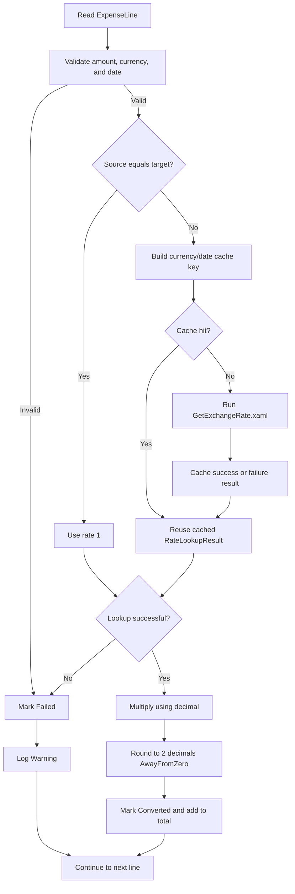

# Exercise 4 findings
[Trace] Execution started for file: GetExchangeRate
[Information] ExpenseClaimConverter execution started
[Information] GetExchangeRate started: base=USD; quote=EUR; date=2026-11-17
[Warning] Invalid input: in_RateDate must not be in the future.
[Information] Exchange-rate outputs: Success=False; Rate=0; RateDate=2026-11-17; ErrorMessage=Invalid input: in_RateDate must not be in the future.
[Information] ExpenseClaimConverter execution ended in: 00:00:00


# `ConvertExpenseClaim.cs` section-by-section

`ConvertExpenseClaim.cs` is the process orchestrator. It does not contain the CSV parser or validation algorithms directly; it coordinates:

- `ExpenseCsv` for reading and writing CSV.
- `ExpenseCalculator` for normalization, validation, cache-key creation, and rounding.
- `GetExchangeRate.xaml` for external exchange-rate lookup.
- `ExpenseLine` for the typed input/output row model.

No files were changed while preparing this explanation.

---

## 1. Workflow signature and defaults

```csharp
[Workflow]
public void Execute(
    string in_InputPath = "Data/Input/expenses.csv",
    string in_OutputPath = "Data/Output/expenses_converted.csv",
    string in_TargetCurrency = "EUR")
```

The workflow has three optional inputs:

| Argument | Default | Purpose |
|---|---|---|
| `in_InputPath` | `Data/Input/expenses.csv` | Source CSV |
| `in_OutputPath` | `Data/Output/expenses_converted.csv` | Destination CSV |
| `in_TargetCurrency` | `EUR` | Currency to convert into |

Relative paths are resolved against the process working directory.

---

## 2. Run-level counters

```csharp
int linesRead;
var convertedCount = 0;
var failedCount = 0;
var total = 0m;
```

These variables track the whole run:

- `linesRead`: number of nonblank input records.
- `convertedCount`: successfully converted lines.
- `failedCount`: lines rejected by validation or failed by exchange-rate lookup.
- `total`: sum of converted line amounts.

`total` is a `decimal`, not a `double`.

`linesRead` is assigned after the CSV is successfully read:

```csharp
var lines = ExpenseCsv.Read(inputPath);
linesRead = lines.Count;
```

---

## 3. Target-currency normalization and validation

```csharp
var targetCurrency =
    ExpenseCalculator.NormalizeCurrency(in_TargetCurrency);
```

`NormalizeCurrency`:

1. Converts `null` to an empty string.
2. Trims whitespace.
3. Converts the result to uppercase using invariant culture.

Examples:

```text
" eur " → "EUR"
"usd"   → "USD"
null    → ""
```

Then the format is validated:

```csharp
if (!ExpenseCalculator.IsValidCurrency(targetCurrency))
{
    throw new BusinessRuleException(
        "Invalid target currency: must be exactly 3 letters.");
}
```

The validation pattern is:

```text
^[A-Z]{3}$
```

This validates the shape of the target currency. It does not check whether the currency is supported by Frankfurter.

An invalid target currency stops the whole run because no line can be converted reliably.

---

## 4. Path resolution and start logging

```csharp
var inputPath = ResolvePath(in_InputPath, "in_InputPath");
var outputPath = ResolvePath(in_OutputPath, "in_OutputPath");
```

`ResolvePath` rejects null, empty, or whitespace-only paths:

```csharp
private static string ResolvePath(string path, string argumentName)
{
    if (string.IsNullOrWhiteSpace(path))
    {
        throw new BusinessRuleException(argumentName + " is required.");
    }

    return Path.GetFullPath(path);
}
```

The start log contains file names rather than full paths:

```csharp
Log("Expense conversion started: input=" +
    Path.GetFileName(inputPath) +
    "; output=" +
    Path.GetFileName(outputPath) +
    "; target=" +
    targetCurrency);
```

Example:

```text
Expense conversion started: input=expenses.csv; output=expenses_converted.csv; target=EUR
```

---

## 5. Reading the CSV

```csharp
var lines = ExpenseCsv.Read(inputPath);
linesRead = lines.Count;
```

`ExpenseCsv.Read`:

1. Checks that the file exists.
2. Reads the complete file.
3. Parses CSV fields, including quoted fields.
4. Reads the header row.
5. Locates the required columns:
   ```text
   LineId
   ExpenseDate
   Description
   Amount
   Currency
   ```
6. Creates one `ExpenseLine` object per nonblank record.

The original values are retained as strings:

```csharp
public sealed class ExpenseLine
{
    public string LineId { get; set; }
    public string ExpenseDate { get; set; }
    public string Description { get; set; }
    public string Amount { get; set; }
    public string Currency { get; set; }

    public decimal? Rate { get; set; }
    public DateTime? RateDate { get; set; }
    public decimal? ConvertedAmount { get; set; }
    public string Status { get; set; }
    public string Message { get; set; }
}
```

The derived fields are nullable so failed rows can leave them blank in the output.

---

## 6. Creating the exchange-rate cache

```csharp
var rateCache =
    new Dictionary<string, RateLookupResult>(
        StringComparer.Ordinal);
```

The cache exists only during the current execution.

A cache key is built from:

```csharp
var cacheKey = ExpenseCalculator.CreateRateCacheKey(
    validation.NormalizedCurrency,
    validation.ExpenseDate);
```

The key format is:

```text
<source currency>|<date>
```

For example:

```text
USD|2026-11-03
```

The target currency is not included because one run uses one fixed target currency.

---

# How one line flows through the workflow

Each input record is processed by:

```csharp
foreach (var line in lines)
{
    ...
}
```

The path is:



---

## 7. Line validation

```csharp
var validation =
    ExpenseCalculator.Validate(line, DateTime.Today);
```

Validation occurs in this order.

### 7.1 Null-line validation

```csharp
if (line == null)
{
    return new ValidationResult
    {
        Message = "Line is required."
    };
}
```

The CSV reader normally does not create null rows, but the helper handles the case.

### 7.2 Amount validation

```csharp
decimal amount;
if (!decimal.TryParse(
        (line.Amount ?? string.Empty).Trim(),
        NumberStyles.Number,
        CultureInfo.InvariantCulture,
        out amount) || amount <= 0m)
{
    return new ValidationResult
    {
        Message = "Amount must be a number greater than 0."
    };
}
```

The amount must:

- Parse successfully as a `decimal`.
- Be greater than zero.

Examples that fail:

```text
-5.00
0
abc
empty value
```

### 7.3 Currency validation

```csharp
var normalizedCurrency =
    NormalizeCurrency(line.Currency);

if (!IsValidCurrency(normalizedCurrency))
{
    return new ValidationResult
    {
        Message = "Currency must be exactly 3 letters."
    };
}
```

Examples:

```text
"usd" → "USD" → valid
" USD " → "USD" → valid
"US" → "US" → invalid
"XYZ" → "XYZ" → syntactically valid
```

`XYZ` passes local format validation because it contains three letters. Whether it is supported is determined by `GetExchangeRate.xaml`.

### 7.4 Exact date-format validation

The current implementation uses:

```csharp
DateTime expenseDate;

if (!DateTime.TryParseExact(
        (line.ExpenseDate ?? string.Empty).Trim(),
        "yyyy-MM-dd",
        CultureInfo.InvariantCulture,
        DateTimeStyles.None,
        out expenseDate))
{
    return new ValidationResult
    {
        Message = "Invalid date format, expected yyyy-MM-dd"
    };
}
```

Accepted example:

```text
2026-11-03
```

Rejected examples:

```text
11/03/2026
03-11-2026
2026/11/03
2026-11-3
2026-11-03T00:00:00
```

Whitespace around the date is trimmed first, so this is accepted:

```text
" 2026-11-03 "
```

The date is then normalized to date-only:

```csharp
expenseDate = expenseDate.Date;
```

### 7.5 Future-date validation

```csharp
if (expenseDate > today.Date)
{
    return new ValidationResult
    {
        Message = "ExpenseDate must not be in the future."
    };
}
```

`today` is passed from the workflow as:

```csharp
DateTime.Today
```

If the date is valid and not in the future, the helper returns:

```csharp
return new ValidationResult
{
    IsValid = true,
    Amount = amount,
    NormalizedCurrency = normalizedCurrency,
    ExpenseDate = expenseDate,
    Message = string.Empty
};
```

---

## 8. Invalid-line path

If validation fails:

```csharp
if (!validation.IsValid)
{
    MarkFailed(line, validation.Message);
    failedCount++;

    Log(
        "Line failed: LineId=" + line.LineId +
        "; reason=" + validation.Message,
        LogLevel.Warn);

    continue;
}
```

`MarkFailed` clears derived values and sets the failure information:

```csharp
private static void MarkFailed(
    ExpenseLine line,
    string message)
{
    line.Rate = null;
    line.RateDate = null;
    line.ConvertedAmount = null;
    line.Status = "Failed";
    line.Message = message ?? "Conversion failed.";
}
```

The `continue` statement skips lookup and rounding for this line and moves to the next line.

For example:

```text
LineId: 7
Amount: -5.00
```

becomes:

```text
Status: Failed
Message: Amount must be a number greater than 0.
```

---

## 9. Same-currency path

After validation:

```csharp
if (validation.NormalizedCurrency == targetCurrency)
{
    lookup = new RateLookupResult(
        true,
        1m,
        validation.ExpenseDate,
        string.Empty);
}
```

For an `EUR` line when the target is `EUR`:

- No API call occurs.
- No cache entry is created.
- Rate is `1m`.
- Rate date is the requested expense date.
- The line still goes through decimal multiplication and two-decimal rounding.

For example:

```text
62.00 EUR × 1 = 62.00 EUR
```

---

## 10. Non-identity cache lookup

If source and target currencies differ:

```csharp
var cacheKey =
    ExpenseCalculator.CreateRateCacheKey(
        validation.NormalizedCurrency,
        validation.ExpenseDate);
```

Then:

```csharp
if (!rateCache.TryGetValue(cacheKey, out lookup))
{
    ...
}
```

### Cache hit

If the key already exists, the stored `RateLookupResult` is reused.

The child workflow is not called again.

### Cache miss

If the key is absent, the workflow invokes `GetExchangeRate.xaml`.

Both successful and failed lookup results are stored:

```csharp
rateCache.Add(cacheKey, lookup);
```

Therefore, repeated unsupported currency/date combinations also avoid repeated API calls.

---

## 11. Invoking `GetExchangeRate.xaml`

The parent invokes the child using:

```csharp
var exchangeRateOutputs = RunWorkflow(
    "GetExchangeRate.xaml",
    new Dictionary<string, object>
    {
        {
            "in_BaseCurrency",
            validation.NormalizedCurrency
        },
        {
            "in_QuoteCurrency",
            targetCurrency
        },
        {
            "in_RateDate",
            validation.ExpenseDate
        }
    });
```

The child receives:

| Child input | Value |
|---|---|
| `in_BaseCurrency` | Normalized source currency |
| `in_QuoteCurrency` | Normalized target currency |
| `in_RateDate` | Parsed `yyyy-MM-dd` date |

The generated typed accessor was not usable for this existing XAML workflow because it exposed no arguments or return value. The code therefore uses the documented `RunWorkflow` dictionary-based fallback.

The parent expects these child outputs:

```text
out_Success
out_Rate
out_RateDate
out_ErrorMessage
```

They are converted into a typed result:

```csharp
lookup = new RateLookupResult(
    Convert.ToBoolean(
        exchangeRateOutputs["out_Success"]),

    Convert.ToDecimal(
        exchangeRateOutputs["out_Rate"],
        CultureInfo.InvariantCulture),

    Convert.ToDateTime(
        exchangeRateOutputs["out_RateDate"],
        CultureInfo.InvariantCulture),

    exchangeRateOutputs["out_ErrorMessage"]
        ?.ToString()
        ?? string.Empty);
```

---

## 12. What `GetExchangeRate.xaml` does

The child workflow:

1. Normalizes its currency inputs.
2. Validates the three-letter currency shapes.
3. Rejects future dates.
4. Uses rate `1` for same-currency requests.
5. Builds the Frankfurter API URL for different currencies.
6. Executes the HTTP request.
7. Retries transient server failures and timeouts.
8. Handles HTTP status codes.
9. Parses the returned JSON array.
10. Selects the requested quote currency.
11. Returns the API-provided rate and date.

The parent does not perform HTTP status handling itself. It relies on the child’s output contract.

The child’s `out_RateDate` is used as the authoritative returned date. This allows the API to return a different business date for a weekend or holiday.

---

## 13. Failed exchange-rate result

After either a same-currency result, cache hit, or child call, the parent checks:

```csharp
if (!lookup.Success)
{
    MarkFailed(line, lookup.ErrorMessage);
    failedCount++;

    Log(
        "Line failed: LineId=" + line.LineId +
        "; reason=" + lookup.ErrorMessage,
        LogLevel.Warn);

    continue;
}
```

For an unsupported currency:

```text
Success = false
ErrorMessage = Currency or date not supported
```

the output line becomes:

```text
Status = Failed
Message = Currency or date not supported
Rate = blank
RateDate = blank
ConvertedAmount = blank
```

This is a line-level failure, so later lines continue processing.

Important distinction:

- A child workflow returning `out_Success=False` fails only that line.
- A child workflow throwing an unexpected exception is caught by the outer catch and stops the whole run.

---

## 14. Successful conversion and rounding

For a successful lookup:

```csharp
line.Rate = lookup.Rate;
line.RateDate = lookup.RateDate;
line.ConvertedAmount =
    ExpenseCalculator.CalculateConvertedAmount(
        validation.Amount,
        lookup.Rate);
line.Status = "Converted";
line.Message = string.Empty;
```

The calculation is:

```csharp
public static decimal CalculateConvertedAmount(
    decimal amount,
    decimal rate)
{
    return Math.Round(
        amount * rate,
        2,
        MidpointRounding.AwayFromZero);
}
```

For example:

```text
Amount = 45.50
Rate = 0.89367

45.50 × 0.89367 = 40.661985
Rounded result = 40.66
```

The workflow then updates the total:

```csharp
total += line.ConvertedAmount.Value;
convertedCount++;
```

The total is the sum of already-rounded successful line amounts.

---

## 15. Writing the output

After all input rows are processed:

```csharp
ExpenseCsv.Write(
    outputPath,
    lines,
    total,
    targetCurrency);
```

The output columns are:

```text
LineId,
ExpenseDate,
Description,
Amount,
Currency,
Rate,
RateDate,
ConvertedAmount,
Status,
Message
```

A successful line contains values such as:

```text
1,2026-11-03,Taxi airport to hotel,45.50,USD,0.89367,2026-11-03,40.66,Converted,
```

A failed line contains blank derived values:

```text
7,2026-11-05,Negative amount test,-5.00,USD,,,,Failed,Amount must be a number greater than 0.
```

The total row is constructed as:

```text
LineId = TOTAL
ConvertedAmount = total
Status = Total
Message = Total in EUR
```

The total is written in the `ConvertedAmount` column.

The writer:

- Creates the output directory if needed.
- Overwrites an existing output file.
- Writes UTF-8 without a BOM.
- Escapes commas, quotes, and line breaks in field values.

---

## 16. End logging

After the output file is written:

```csharp
Log("Expense conversion ended: linesRead=" +
    linesRead +
    "; converted=" +
    convertedCount +
    "; failed=" +
    failedCount +
    "; total=" +
    total.ToString(
        "0.00",
        CultureInfo.InvariantCulture) +
    " " +
    targetCurrency);
```

Example:

```text
Expense conversion ended: linesRead=8; converted=5; failed=3; total=919.91 EUR
```

The counters describe line outcomes, not API-call counts.

---

## 17. Exception handling

The whole process is wrapped in `try/catch`.

### Business-rule and configuration failures

```csharp
catch (BusinessRuleException exception)
{
    Log(
        "Expense conversion configuration error: " +
        exception.Message,
        LogLevel.Warn);
    throw;
}
```

Examples:

- Invalid target currency.
- Missing input path.
- Missing output path.

These are logged and rethrown.

### Unexpected failures

```csharp
catch (Exception exception)
{
    Log(
        "Expense conversion unexpected error: " +
        exception.Message,
        LogLevel.Error);
    throw;
}
```

Examples:

- Input file cannot be read.
- CSV structure is malformed.
- Output file cannot be written.
- A required child output is missing.
- `GetExchangeRate.xaml` throws unexpectedly.

The exception is rethrown so the process does not appear successful after a run-level failure.

---

# Example complete line flows

## Successful foreign-currency line

Input:

```text
1,2026-11-03,Taxi airport to hotel,45.50,USD
```

Target:

```text
EUR
```

Flow:

1. Amount parses as `45.50m`.
2. Currency normalizes to `USD`.
3. Date matches exact format `yyyy-MM-dd`.
4. Date is not in the future.
5. Source differs from target.
6. Cache key is:
   ```text
   USD|2026-11-03
   ```
7. Cache miss invokes `GetExchangeRate.xaml`.
8. Child returns a rate such as `0.89367`.
9. Result is cached.
10. `45.50 × 0.89367` is rounded to `40.66`.
11. Line status becomes `Converted`.
12. `40.66` is added to the total.

## Successful same-currency line

Input:

```text
4,2026-11-04,Train ticket,62.00,EUR
```

Target:

```text
EUR
```

Flow:

1. Validation succeeds.
2. Source equals target.
3. No cache lookup occurs.
4. No child workflow or HTTP call occurs.
5. Rate is `1m`.
6. Converted amount is `62.00`.
7. Line status becomes `Converted`.

## Invalid-format date

Input:

```text
9,11/05/2026,Invalid date,10.00,USD
```

Flow:

1. Amount passes.
2. Currency passes.
3. `TryParseExact("yyyy-MM-dd", ...)` fails.
4. The line becomes:
   ```text
   Status = Failed
   Message = Invalid date format, expected yyyy-MM-dd
   ```
5. No cache lookup or API call occurs.
6. Processing continues with the next line.

---

# Assumptions

The following are assumptions or implementation decisions made beyond the literal workflow requirements.

## Input and target-currency assumptions

1. The target currency applies to every input line in the run.
2. The target currency should be trimmed and uppercased before validation.
3. A target currency must have exactly three uppercase ASCII letters after normalization.
4. Local validation checks currency shape, not complete ISO-4217 support.
5. Unsupported target currencies are expected to be reported by `GetExchangeRate.xaml` or the API.
6. A missing or whitespace-only target currency is a run-level configuration failure.
7. The target currency is fixed, so it does not need to be included in cache keys.
8. Relative paths should be resolved against the process working directory.
9. A missing or whitespace-only input/output path is a run-level configuration failure.

## CSV assumptions

10. The input CSV has a header row.
11. The required headers use these exact names and casing:
    ```text
    LineId, ExpenseDate, Description, Amount, Currency
    ```
12. Required columns may be in any order because they are located by header name.
13. Additional input columns are tolerated during reading but are not copied to the output.
14. Header names are treated as exact strings after trimming.
15. Duplicate headers are invalid.
16. Nonblank data rows should contain the same number of fields as the header.
17. Blank rows are ignored.
18. Standard quoted CSV fields are supported.
19. A malformed CSV structure is treated as a file-level failure, not a line-level failure.
20. A file containing only a header is accepted and produces an output with no converted data rows plus a total of zero.
21. The input file is readable as normal text using the machine’s default file-reading behavior.
22. An existing output file may be overwritten.
23. The output directory may be created automatically.
24. Output writing does not need a temporary file and atomic rename.

## Amount assumptions

25. Amounts are parsed with invariant culture.
26. Amounts must be valid `decimal` values.
27. Amounts must be greater than zero.
28. `NumberStyles.Number` allows standard number formatting such as signs, decimal points, thousands separators, and surrounding whitespace.
29. Locale-specific decimal conventions are not specially supported.
30. Amounts with commas may need CSV quoting because commas are also field separators.
31. All arithmetic, including the total, must use `decimal`.
32. No floating-point `double` conversion is intended.
33. The output rate is displayed with at most five decimal places, although the internal rate remains a decimal value.

## Currency assumptions

34. Currency values are trimmed and uppercased before comparison.
35. Lowercase currency codes are accepted.
36. Currency codes with fewer or more than three letters fail local validation.
37. Three-letter codes such as `XYZ` pass local format validation.
38. Actual currency support is delegated to `GetExchangeRate.xaml`.
39. Source and target currency comparisons use normalized values.

## Date assumptions

40. The input date must be exactly `yyyy-MM-dd` after trimming outer whitespace.
41. Dates such as `11/03/2026`, `2026/11/03`, and `2026-11-3` are invalid.
42. Date parsing uses `DateTime.TryParseExact`.
43. `InvariantCulture` is used for date parsing.
44. `DateTimeStyles.None` is used.
45. The parsed date is reduced to date-only with `.Date`.
46. “Today” means the local machine’s `DateTime.Today`.
47. A date later than the local machine’s date is invalid.
48. Date validation occurs after amount and currency validation, so if multiple fields are invalid, the first validation failure in that order is returned.
49. The input date is passed to `GetExchangeRate.xaml` as a `DateTime`.
50. The date returned by `GetExchangeRate.xaml` is authoritative for `RateDate`.
51. A returned date may differ from the requested date because of API business-date behavior.

## Cache assumptions

52. The cache exists only for one execution.
53. A cache key contains normalized source currency and date:
    ```text
    Currency|yyyy-MM-dd
    ```
54. The target currency is omitted from the key because it is constant during the run.
55. A given source-currency/date pair produces a reusable result during the run.
56. Successful results are cached.
57. Failed lookup results are also cached.
58. Same-currency conversions bypass both the cache and the child workflow because no lookup is necessary.
59. Cache contents are not persisted between executions.
60. The cache is single-threaded because the workflow processes lines sequentially.

## `GetExchangeRate.xaml` assumptions

61. `GetExchangeRate.xaml` is available at the project-relative path:
    ```text
    GetExchangeRate.xaml
    ```
62. The child inputs are exactly:
    ```text
    in_BaseCurrency
    in_QuoteCurrency
    in_RateDate
    ```
63. The child outputs are exactly:
    ```text
    out_Success
    out_Rate
    out_RateDate
    out_ErrorMessage
    ```
64. All four expected output keys are present for both successful and unsuccessful child results.
65. The values in the output dictionary can be converted to the expected Boolean, Decimal, DateTime, and String types.
66. The child workflow owns HTTP status handling, retry handling, JSON parsing, and API-specific error mapping.
67. The parent should not add a second retry layer around the child.
68. `RunWorkflow` executes synchronously.
69. A child result with `out_Success=False` is a line-level failure.
70. An exception thrown by the child is an unexpected run-level failure.
71. The child’s returned rate date should be written to the output rather than always using the requested date.
72. The dictionary-based `RunWorkflow` fallback is acceptable because the generated typed accessor did not expose the XAML arguments and outputs correctly.

## Rounding and totals assumptions

73. Each successful line is rounded to two decimal places.
74. Rounding uses `MidpointRounding.AwayFromZero`.
75. The total is the sum of rounded line values, not the sum of unrounded products.
76. Failed lines do not contribute to the total.
77. Same-currency lines also go through the same rounding method.
78. No additional final rounding step is required because each contributing line has two decimal places.

## Output assumptions

79. Successful lines use:
    ```text
    Status = Converted
    ```
80. Failed lines use:
    ```text
    Status = Failed
    ```
81. The total row uses:
    ```text
    Status = Total
    ```
82. Failed rows retain their original input fields.
83. Failed rows have blank rate, rate date, and converted amount fields.
84. The total is stored in the `ConvertedAmount` column.
85. The total row uses `LineId = TOTAL`.
86. The total row message is:
    ```text
    Total in <target currency>
    ```
87. The output uses the original input date and amount text for the original columns.
88. Output rate formatting is limited to five displayed decimal places.
89. Output converted amounts use two displayed decimal places.
90. Output is UTF-8 without a BOM.
91. A line-level failure should not stop later lines.
92. File-level, configuration-level, output, and unexpected runtime failures should stop the run.

## Logging assumptions

93. Full input and output paths should not be logged.
94. The start log uses only file names and the normalized target currency.
95. A failed line log includes its `LineId` and failure reason.
96. Line-level validation and lookup failures are logged at Warning level.
97. Configuration `BusinessRuleException` failures are logged at Warning level.
98. Unexpected exceptions are logged at Error level.
99. Exceptions are rethrown after logging rather than swallowed.
100. The workflow’s end summary is logged only if the output file is successfully written.
101. The summary’s `linesRead` counts input records, while `converted` and `failed` count line outcomes—not unique cache keys or API requests.

